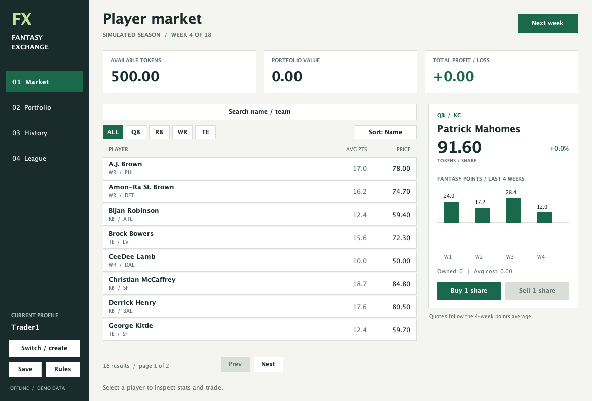

# Fantasy Exchange

A Java fantasy football stock exchange using ACM graphics. Start with 500 virtual tokens, buy player shares, advance a simulated NFL season, and compare your portfolio with other profiles on the same computer.

Based on [RohanDhameja/DSA-FallProject](https://github.com/RohanDhameja/DSA-FallProject), inspected at commit `58c77a88bf9d93a7905f2f0a831efb9b846b4e30`.

Original project team: Rohan Dhameja, Sohan Vaddepuri, Owen Werner. This extension retains the original class model and the original Mahomes and Jefferson sample histories. The README, tests, persistence, and expanded interface accompany the updated implementation.



## Run

Use **JDK 17**, including `javac`, and a desktop display. No Maven, API account, or network connection is needed. The included `acm.jar` supplies `GCanvas`, `GRect`, `GLabel`, and `GLine`. A standard `JFrame` hosts the ACM canvas, avoiding the old applet-based `GraphicsProgram` launcher.

Mac or Linux, from this folder:

```sh
sh run.sh
```

Windows, from this folder:

```bat
run.bat
```

Manual commands on Mac/Linux:

```sh
mkdir -p build
javac -cp acm.jar -d build *.java
java -cp "build:acm.jar" FantasyExchangeGUI
```

On Windows, use `"build;acm.jar"` for the runtime classpath.

The downloadable bundle also includes a built `FantasyExchange.jar`. Keep it beside `acm.jar` and launch with `java -jar FantasyExchange.jar`. Rebuild it with `sh build.sh` or `build.bat`.

In jGRASP, add this folder's `acm.jar` to the project's classpath, compile the Java files, and run `FantasyExchangeGUI.main`. In VS Code, open the whole folder and select the supplied Java launch configuration. Use the project root as the working directory so the same save loads each time.

The default canvas is 1180 x 800. If you make it smaller than 1000 x 720, the app asks you to enlarge it.

## Play

1. Click a market row to inspect the player. Buy or sell one share with the buttons on the right. You may own multiple shares of the same player, up to 100 shares total.
2. Search a partial player name or team. Leave the search blank to clear it. Click ALL, QB, RB, WR, or TE to filter. The sort button cycles through name, ascending price, descending price, and average points.
3. Open Portfolio to see holdings, History to see receipts, or League to compare net worth.
4. Click Next week to update all players. The confirmation applies to every local profile. Trading continues through week 18, but the season cannot advance past week 18.
5. Use Switch / create to open another local profile. Names are case-insensitive and use 1-18 letters, numbers, or underscores. Each new profile gets 500 tokens. These profiles have no passwords and are not online accounts.

Keyboard shortcuts: `1` Market, `2` Portfolio, `3` History, `4` League, `/` Search, `N` Next week. Click the canvas first if it does not have keyboard focus.

## Data and scoring

**All statistics are synthetic classroom data.** The player/team labels form a fixed sample roster, not a claim about current rosters. There is no live NFL API. A deterministic simulation makes a given player's result in a given week repeatable, including after saving and reopening.

Each player's `int[4][3] weeklyStats` uses rows for the last four weeks and columns for yards, touchdowns, and turnovers. The simulation stores one simplified yardage category per position.

- QB: `yards * 0.04 + touchdowns * 4 - turnovers * 2`.
- RB, WR, TE: `yards * 0.1 + touchdowns * 6 - turnovers * 2`.
- Quote: `max(5, 10 + fourWeekAveragePoints * 4)`, rounded to two decimal places.
- Net worth: available tokens plus current holdings value.
- Total profit: current holdings value plus all sale proceeds minus all purchase costs. It includes realized and unrealized profit.
- Average cost: average purchase price of the shares still held, using first-in, first-out sales.

This is a simplified non-PPR classroom scoring system. There are no receptions, kickers, defenses, transaction fees, real funds, or online competition. New profiles can join midseason, so the local leaderboard is a demonstration, not a fair competition with enforced start dates.

## Saving

Trades, new weeks, and profile changes save automatically to `data/exchange.dat`. The Save button also writes a snapshot. Every profile and the shared market live in the same file. Only run one application instance per save file.

The save manager writes a temporary file before replacing the destination. If saving fails, the status bar says so and the current session remains usable. Click Save to retry before closing. If loading fails, the app leaves the old file untouched and disables writes for that session. Close the app and rename the damaged file before restarting.

To start a fresh season, close the app and rename `data/exchange.dat`, keeping it as a backup. To use a separate save:

```sh
java -Dfantasy.save=data/another-season.dat -cp "build:acm.jar" FantasyExchangeGUI
```

## Project requirements

- Java: nine production classes, including the eight original UML classes and a save helper.
- ACM graphics: the entire app surface uses ACM objects, with standard dialogs for text input and confirmation.
- Multidimensional arrays: `Player.weeklyStats` and the initial `String[][]` roster.
- ArrayLists: market, registered users, owned shares, receipts, filtered lists, merge-sort halves, and clickable areas.
- Algorithms: sequential search, filtering, accumulation, counting, stable recursive merge sort, and FIFO cost tracking.
- Javadoc: source comments use `/** ... */` without decorative leading asterisks.
- UML: [class diagram](docs/UML.md) and [printable diagram](docs/UML.svg).
- Code review: [six-slide presentation](docs/CODE_REVIEW.html) and [speaker notes](docs/CODE_REVIEW.md). Download the project, open the HTML in a browser, and use the arrow keys. The slides also have a landscape print layout.
- Videos: [demo plan and music-video checklist](docs/VIDEO_PLAN.md). The students still need to record both required videos and appear in the music video.
- Quiz practice: [small methods to reconstruct](docs/PRACTICE.md). Working versions remain in the app.

## Checks

Run the model checks:

```sh
sh test.sh
```

On Windows use `test.bat`.

Run the interface logic and rendering checks, without opening a window:

```sh
javac -cp "build:acm.jar" -d build tests/GuiTest.java
java -Djava.awt.headless=true -cp "build:acm.jar" GuiTest
```

On Windows change the classpath separators to semicolons. GUI checks exercise actual click handlers and render the actual ACM objects. They do not verify native dialog behavior or keyboard focus in a real desktop window.

Generate Javadoc:

```sh
javadoc -quiet -Xdoclint:all,-missing -classpath acm.jar -d build/javadoc *.java
```

## Changes from the initial project

The original eight classes remain. `User.tokens` now stores hundredths internally and `getBalance()` returns a `double`, so fractional prices no longer silently truncate. Buy/sell methods now return success flags. The market data manager advances a real simulated season. Profit uses the receipt ledger. The UI handles all listed players, includes selling, and uses `GCanvas` inside a `JFrame`. `SaveManager` is the only new top-level application class.

The group should review and understand the extended code before the code review or quiz. The small practice methods are starting points for that review, not claims about who wrote which lines.

## Dependency

`acm.jar` is the ACM Java Task Force graphics library, already used in the original project and provided locally for this build. Its bundled notices remain intact. The project does not grant a new license to the upstream group's code.
