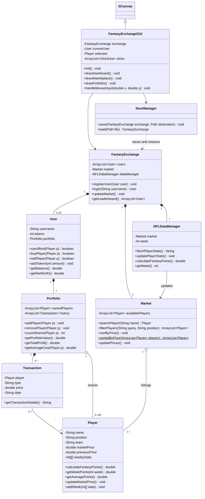

# Fantasy Exchange class diagram

The eight original classes remain. `SaveManager` adds file persistence. The GUI extends ACM `GCanvas`, hosted by a standard Java `JFrame`.

`User.tokens` stores hundredths of a token, while the public balance uses token units. Portfolio references can repeat because one list entry represents one share. All profiles reference the same market Player objects, so prices update consistently.
